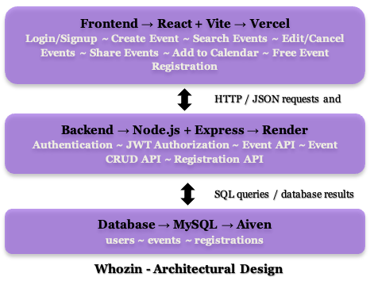

# Whozin – Who's In

**COMP 3415 – Software Engineering Project | Lakehead University**  
**P3 – Iteration Release I | November 8, 2026**

> A centralized event discovery and promotion platform for the Thunder Bay community.

**Live application:** https://whozin-navy.vercel.app/  
**Team repository:** https://github.com/JINAL-1/Whozin

> **Deployment note:** The frontend is hosted on Vercel, the API on Render, and the database on Aiven MySQL. The Render service uses a free tier and may take extra time to respond after inactivity.

## Team

**Team Name:** Whozin (Who's In)

| Team Member | Email |
|---|---|
| Pranavv Patel | ppate218@lakeheadu.ca |
| Jinal Parekh | jparekh5@lakeheadu.ca |
| Dean Facho | dfacho@lakeheadu.ca |
| Julia Petterle | jgpetter@lakeheadu.ca |
| Krishi Patel | kpate176@lakeheadu.ca |

## Project Overview

Event information in Thunder Bay is spread across social media, posters, and individual organization websites. Whozin makes local events easier to discover and promote through a centralized web application for attendees and organizers.

**P3 milestone:** Whozin has progressed from the initial P2 prototype to a publicly deployed, integrated application. Iteration P3 expanded event management, made search reliable against the real API, introduced individual event pages and external sharing, added downloadable calendar events, and implemented free-event registration with persistent MySQL storage. Whozin is still an evolving course project; not all planned stories are implemented.

## P3 Features

- **Accounts and authentication (US-01):** Attendee and organizer signup/login, with JWT authentication and role-based restrictions.
- **Create events (US-02):** Authenticated organizers can create events saved through the API to MySQL.
- **Edit and cancel events (US-03):** Organizers can update or cancel their events.
- **Search events (US-05):** Search by keyword and location using the real backend API by default. Loading, empty-results, and server-error states are handled; sample/demo data is used only when `VITE_DEMO_MODE=true`.
- **Register for free events (US-06):** Logged-in attendees can register for eligible free events. The backend validates requests and records registrations in MySQL, with a unique attendee/event constraint to prevent duplicates. Integration was tested against the deployed backend and database.
- **Share events (US-10):** Individual event pages at `/events/:id` support copying a link and sharing via email, WhatsApp, Facebook, and X, with device sharing where supported. **In-app posting to a Whozin feed is not yet implemented.**
- **Add to calendar (US-11):** Download an `.ics` calendar file from event interfaces, including the event details page.

### P3 Product Backlog

The status column below follows the team's submitted P3 report. "Completed" for US-10 refers to the implemented external-sharing scope; the original in-app posting criterion remains outstanding.

| ID | User story | P3 status | Notes |
|---|---|---|---|
| US-01 | Create Account and Log In | Completed | Implemented and tested |
| US-02 | Create Event | Completed | Implemented and tested |
| US-03 | Edit / Cancel Event | Completed | Implemented and tested |
| US-04 | Personalized Event Feed | To Do | Not implemented |
| US-05 | Search Events by Location and Keyword | Completed | Reliable API search and expanded tests; live MySQL integration verified |
| US-06 | Register for Free Event | Completed | Implemented and tested with deployed API and MySQL |
| US-07 | Purchase Tickets with Stripe | To Do | Not implemented |
| US-08 | View and Present My Tickets | To Do | Not implemented |
| US-09 | Cancel Registration or Request Refund | To Do | Not implemented |
| US-10 | Share Events | Completed (external sharing) | Copy/external share implemented; in-app posts remain outstanding |
| US-11 | Add to Calendar (`.ics`) | Completed | Calendar download integrated into event pages |
| US-12 | Notifications and Reminders | To Do | Not implemented |

## Technology Stack and Deployment

| Layer | Technology / Hosting | Responsibility |
|---|---|---|
| Frontend | React, Vite, JavaScript, HTML, CSS / **Vercel** | Pages, search, event management, sharing, calendar downloads, registration UI |
| Backend | Node.js, Express / **Render** | REST API, event operations, registration validation, authentication and authorization |
| Database | MySQL / **Aiven** | Persistent `users`, `events`, and `registrations` records |
| Authentication | JWT | Authenticate protected API requests and enforce user roles |
| Testing | Vitest, React Testing Library, ESLint, Vite build | Automated frontend checks and build validation |
| Collaboration | Git, GitHub | Branches, pull requests, code review, and integration |

### Current Architecture

The following diagram illustrates WHOZIN's three-tier architecture
and its production deployment infrastructure.



The frontend manages the user interface, including external share links and `.ics` generation. The backend validates protected actions and reads/writes persistent data. The P3 iteration introduced an individual event details route (`/events/:id`) used by sharing, calendar integration, and free registration. The registration schema links attendees and events and enforces uniqueness for each attendee/event pair.

## Run WHOZIN Locally (TA Setup)

> **You can use the public deployment above without installing anything.** The following steps run a separate local instance. Keep the backend and frontend in separate terminals. Local data does not automatically sync with Aiven unless explicitly configured to use the same database.

### Prerequisites

- Git
- Node.js and npm (use a Node.js version compatible with the installed Vite release)
- MySQL Server and a MySQL account permitted to create/import the schema, **or** authorized access to a separately configured MySQL instance

### 1. Clone and install dependencies

```bash
git clone https://github.com/JINAL-1/Whozin.git
cd Whozin

cd backend
npm install
cd ../frontend
npm install
cd ..
```

### 2. Initialize the local MySQL database

The schema in `backend/schema.sql` defines the database tables, including the P3 `registrations` table. On a **new local database**, import it from the repository root:

```bash
mysql -u root -p < backend/schema.sql
```

Use `DB_NAME=whozin` if that is the database name created by the schema. **Do not run the entire schema against an existing production database without reviewing it first.** `CREATE TABLE IF NOT EXISTS` does not migrate an existing table or guarantee its columns match the current code.

For an existing database missing only the P3 registration table, inspect the `CREATE TABLE registrations` statement in `backend/schema.sql` and confirm that its foreign-key column types match `users.id` and `events.id` before applying that statement alone.

### 3. Configure backend environment variables

Create `backend/.env` locally. Example for a local MySQL installation:

```dotenv
DB_HOST=localhost
DB_USER=root
DB_PASSWORD=your_local_mysql_password
DB_NAME=whozin
JWT_SECRET=replace_with_a_long_random_secret
PORT=3001
```

Check the backend source and any committed example environment file for the exact supported variable names and additional settings (such as database port or TLS) before starting. `DB_SOCKET` may be used for local socket connections if supported. **Never commit `.env`, credentials, database connection strings, or JWT secrets.**

### 4. Configure frontend environment variables

Create `frontend/.env.local`:

```dotenv
VITE_API_URL=http://localhost:3001
VITE_DEMO_MODE=false
```

With demo mode set to `false`, the frontend uses the API instead of substituting sample data. Confirm the API URL format against the frontend's service configuration if it changes.

### 5. Start the backend (Terminal 1)

```bash
cd backend
npm start
```

The backend is expected at `http://localhost:3001` with the example configuration.

### 6. Start the frontend (Terminal 2)

```bash
cd frontend
npm run dev
```

Open the URL printed by Vite (typically `http://localhost:5173`; another port may be selected).

### 7. Verify the local application

1. Create or log in to an **organizer** account.
2. Create a free test event and verify it appears in Search Events.
3. Edit the event and verify the change; test cancellation using a separate test event.
4. Open an event's `/events/:id` page and test **Copy link**, an external share option, and **Add to Calendar**.
5. Log in as an **attendee**, open a published free event, and select **Register for Free**.
6. Confirm the success message and check the `registrations` table in the database configured for that backend.
7. Attempt to register again and verify that no duplicate registration is stored.

For a local database, you can inspect registration records with:

```sql
USE whozin;
SELECT id, attendee_id, event_id, registered_at
FROM registrations
ORDER BY registered_at DESC;
```

## Automated Tests and Build (P3)

Run the frontend checks **from `frontend/`**, not the repository root:

```bash
cd frontend
npm install
npx vitest run
npm run lint
npm run build
```

**P3 result (November 8, 2026): 66/66 frontend tests passed across six test files.** ESLint and the Vite production build also completed successfully.

| Test file | Passing tests |
|---|---:|
| `CreateEvent.test.jsx` | 5 |
| `components.test.jsx` | 13 |
| `MyEvents.test.jsx` | 8 |
| `SearchEvents.test.jsx` | 10 |
| `shareEvent.test.jsx` | 16 |
| `navigation.test.jsx` | 14 |
| **Total** | **66** |

The P3 test suite includes search loading and server-error states, routing, event management UI, and external sharing behavior. Some tests mock event data or API responses and therefore **are not end-to-end database tests**. The team separately performed manual production integration checks involving the Vercel frontend, Render API, and Aiven MySQL database, including event search and free registration persistence. Rerun the suite on the latest commit because results can change as development continues.

## API Overview (P3)

The following routes are documented from the team's implemented functionality. Refer to `backend/src/routes/` for exact HTTP methods, route names, request payloads, and authorization rules before calling endpoints directly.

| Method | Route / capability | Purpose |
|---|---|---|
| `POST` | `/api/auth/register` | Create attendee or organizer account |
| `POST` | `/api/auth/login` | Authenticate and obtain a JWT |
| `GET` | `/api/events` | Retrieve and search events using keyword/location filters |
| `POST` | `/api/events` | Create an event (organizer authorization required) |
| `PUT` | `/api/events/:id` | Edit an existing event, subject to authorization |
| `PATCH` | `/api/events/:id/cancel` | Cancel an event, subject to authorization |
| See source | Registration route in `backend/src/routes/registration.js` | Register an authenticated attendee for an eligible free event |

**Important:** `/events/:id` is a **frontend page route**. A dedicated backend `GET /api/events/:id` endpoint is planned for a future iteration; the P3 event details page currently retrieves an event through the existing event-list/search service.

## Project Structure

```text
Whozin/
├── backend/                 # Express API, routes, database connection
│   ├── schema.sql           # users, events, registrations schema
│   └── src/
│       └── routes/          # Event, authentication, and registration routes
├── frontend/                # React + Vite application
│   └── src/
│       ├── pages/           # Search, event details, event management, etc.
│       ├── services/        # API services, including registrationApi.js
│       ├── components/      # Reusable event and sharing components
│       └── tests/           # Vitest and React Testing Library
├── docs/                    # Project documentation and design guidelines
└── README.md
```

See `frontend/README.md` for additional frontend information.

## Design and Branding

- Logo assets: `frontend/public/brand/` and `frontend/public/favicon.svg`.
- Design guidelines: [`docs/design-guidelines.md`](docs/design-guidelines.md).

## Known Limitations and Future Work

- **In-app sharing/posts:** External links work, but sharing as a post within Whozin requires user profiles and feeds.
- **Dedicated event-details API:** A future `GET /api/events/:id` endpoint would improve direct event retrieval and handling of cancelled events.
- **Further registration coverage:** Extend automated and regression testing of registration, including deployment/database failure scenarios.
- **Not yet implemented:** Personalized event feed (US-04), Stripe ticket purchases (US-07), digital tickets (US-08), cancellation/refunds (US-09), and notifications/reminders (US-12).
- **Broader product vision:** Richer filters, profiles, social interactions, and additional event-discovery features remain future work.

Whozin's P3 release demonstrates a working, publicly accessible foundation; it is not yet the full planned product.
